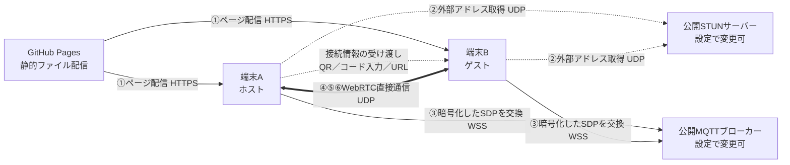
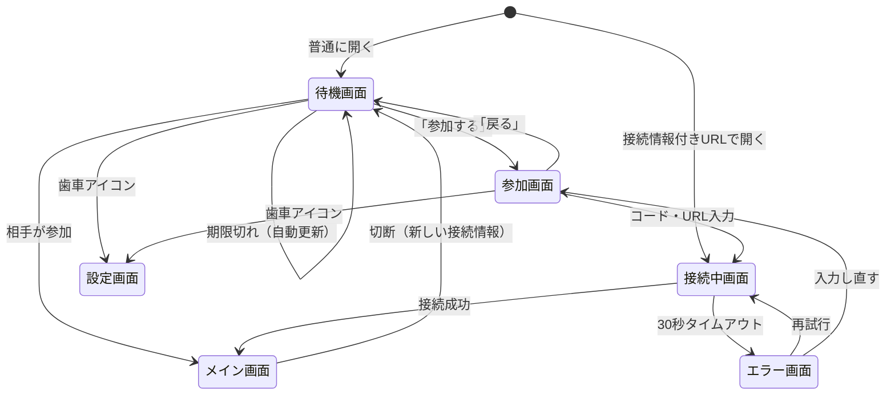

# direct-share 要件定義書

- アプリ名：direct-share（リポジトリ名・公開URLのパスも同名）
- 版数：v0.10
- 更新日：2026-10-24
- ステータス：未決事項なし（実装着手可）

---

## 1. 概要

### 1.1 目的
GitHub Pages で公開する静的Webページだけを使い、任意の2台の端末（PC・スマホを問わない）の間でデータを送受信できるようにする。
カメラの有無にかかわらず、少ない操作で接続できること。

### 1.2 背景
- 自前のサーバー（バックエンド）を持たず、運用コストと管理負担をゼロにしたい
- そのため、端末間の通信は WebRTC による P2P（端末同士の直接通信）で行う

### 1.3 用途
- 2台の端末間での**テキストの交換**（URL、メモ、コピーした文章など）
- 2台の端末間での**ファイルの送受信**（写真、ドキュメントなど）

### 1.4 想定する端末の組み合わせ
| 組み合わせ | 例 |
|---|---|
| PC ⇔ スマホ | PCの資料をスマホへ、スマホの写真をPCへ |
| PC ⇔ PC | カメラのないPC同士でのファイル受け渡し |
| スマホ ⇔ スマホ | 自分の2台のスマホ間 |

---

## 2. 前提・制約

| 項目 | 内容 |
|---|---|
| ホスティング | GitHub Pages のみ（静的ファイルのみ。サーバー処理なし） |
| 費用 | 無料の範囲で実現する |
| アカウント登録 | 利用者・開発者ともに外部サービスへの登録を必要としない |
| 外部依存 | 接続確立時のみ、登録不要の公開インフラ（MQTTブローカー、STUN）を利用する。利用先は設定で変更可能とする |
| ライブラリ | 実行時に使う外部ライブラリは0とし、ブラウザ標準のAPIと自作コードのみで実装する（開発・ビルド用のViteは除く） |
| データ保存 | 送受信データは外部にもブラウザにも保存しない（ブラウザに保存するのは設定値のみ） |

---

## 3. 利用者と利用シーン

### 3.1 想定利用者
- 開発者本人のみ（自分専用ツール）
- ページ自体はGitHub Pagesで公開状態になるが、他者の利用は想定しない
- 利用者がWebRTCやネットワークの知識を持つ前提とし、エラー時の案内は簡潔でよい

### 3.2 役割
端末の種類に関係なく、どちらの端末もどちらの役割にもなれる。

| 役割 | 内容 |
|---|---|
| ホスト | 接続情報（QRコード・接続コード）を表示し、相手の参加を待つ側 |
| ゲスト | ホストの接続情報を読み取る・入力して参加する側 |

ページを普通に開くと、まずホストとして待機する。そこから「参加する」操作をするとゲストになる。接続情報付きのURLで開いた場合は、直接ゲストとして接続する。

### 3.3 接続情報の受け渡し方法

ゲストは、以下のいずれかの方法でホストの接続情報を受け取る。

| No | 方法 | ゲスト側の操作 | 主な用途 |
|---|---|---|---|
| M-1 | OS標準のカメラアプリでQR読み取り | カメラアプリでQRを読み、表示されたURLを開く | スマホがゲスト |
| M-2 | 接続コード・URLの貼り付け | ページを開き「参加する」→ 入力欄に貼り付けて「接続」 | 別の手段（チャット、メール等）でコードやURLを送った場合 |
| M-3 | 接続コードの手入力 | ページを開き「参加する」→ ホスト画面のコードを見ながら入力して「接続」 | PCがゲスト |
| M-4 | 接続情報付きURLを直接開く | 受け取ったURLを開く | 別の手段でURLを送った場合 |

※ ページ内でカメラを起動してQRを読み取る機能は設けない。

### 3.4 利用フロー（例）

**例1：スマホでPCのQRを読む（M-1）**
1. PCでページを開く（ホスト）。QRコードと接続コードが表示される
2. スマホの標準カメラでQRを読み、URLを開く（ゲスト）
3. 自動で接続され、両画面がメイン画面に切り替わる

**例2：PC同士（M-3）**
1. PC-Aでページを開く（ホスト）。接続コードが表示される
2. PC-Bでページを開き、「参加する」を選ぶ
3. PC-Aの画面の接続コードを見ながら、PC-Bで入力して「接続」を押す
4. 自動で接続され、両画面がメイン画面に切り替わる

**共通**
- 接続後は双方向にテキスト・ファイルを送受信できる
- どちらかがページを閉じる、または切断ボタンを押すと切断され、相手側に通知される

---

## 4. 機能要件

### 4.1 接続（ホスト）

| ID | 要件 | 優先度 |
|---|---|---|
| F-01 | ページを（接続情報なしで）開くと、ホストとして接続情報を生成し、QRコードと接続コードを表示する | 必須 |
| F-02 | QRコードの内容は「ページURL＋`#`＋接続情報」とし、標準カメラアプリで読むとそのままゲストとして開ける | 必須 |
| F-03 | 接続コードは手入力しやすい形式で表示する（5.5参照） | 必須 |
| F-04 | 接続コードと接続用URLを、それぞれワンクリック／ワンタップでコピーできる | 必須 |
| F-06 | 接続情報の有効期限は10分とし、期限切れ時は自動で新しい接続情報に切り替える | 必須 |
| F-07 | 手動で接続情報を作り直せる | 必須 |

### 4.2 接続（ゲスト）

| ID | 要件 | 優先度 |
|---|---|---|
| F-11 | 接続情報付きURLでページを開くと、自動でゲストとして接続処理を開始する（M-1, M-4） | 必須 |
| F-12 | ホストの待機画面から「参加する」を選ぶと、参加画面に切り替わる | 必須 |
| F-14 | 参加画面の入力欄に、接続コードまたは接続用URLのどちらを入力・貼り付けしても接続できる（M-2, M-3） | 必須 |
| F-15 | 手入力時は、大文字・小文字の違い、区切り記号や空白の有無、紛らわしい文字（O/0、I/1/Lなど）を吸収して解釈する | 必須 |
| F-17 | 参加画面から待機画面（ホスト）に戻れる | 必須 |

### 4.3 接続（共通）

| ID | 要件 | 優先度 |
|---|---|---|
| F-21 | シグナリングは公開のMQTTブローカー経由で自動実行する（6.2参照） | 必須 |
| F-22 | 接続状態（待機中／接続中／接続済み／切断）を両画面に表示する | 必須 |
| F-23 | ゲストが30秒以内に接続できない場合はエラーを表示し、再試行手段を提供する | 必須 |
| F-24 | 1つのルームに接続できるのは2端末（ホスト1台＋ゲスト1台）までとする | 必須 |

### 4.4 テキストの交換

| ID | 要件 | 優先度 |
|---|---|---|
| F-31 | どちらの端末からでも、テキストを入力して相手に送信できる | 必須 |
| F-32 | 受信したテキストを画面に表示し、ワンクリック／ワンタップでクリップボードにコピーできる | 必須 |
| F-33 | テキスト中のURLは、リンクとして開ける | 推奨 |
| F-34 | 送受信したテキストを、接続中のみ履歴として画面に一覧表示する | 必須 |
| F-35 | 複数行のテキストを送信できる | 必須 |
| F-36 | 1回あたりの最大文字数は10万文字とし、超える場合は送信前に通知する | 必須 |

### 4.5 ファイルの送受信

| ID | 要件 | 優先度 |
|---|---|---|
| F-41 | どちらの端末からでも、ファイルを選択して相手に送信できる | 必須 |
| F-42 | ドラッグ＆ドロップでファイルを選択できる（対応端末のみ） | 推奨 |
| F-43 | 端末標準のファイル選択機能を使い、スマホでは写真ライブラリやカメラからも選択できる | 必須 |
| F-44 | 複数ファイルをまとめて選択・送信できる（1ファイルずつ順に送信） | 推奨 |
| F-45 | 送信側・受信側の両方に、進捗（％）を表示する | 必須 |
| F-46 | 送信中・送信待ちのファイルをキャンセルできる | 推奨 |
| F-47 | 受信したファイルは自動で受け入れ、ファイル名・サイズとともに一覧表示し、保存ボタンで端末に保存できる | 必須 |
| F-49 | 大きなファイルは分割（チャンク）して送信し、受信側で結合する。送信側は送信バッファの残量を見て送信速度を調整する | 必須 |
| F-50 | 1ファイルあたりの最大サイズは100MBとし、送信前にサイズを確認して超える場合は送信を拒否・通知する | 必須 |
| F-51 | 受信ファイルは保存後にメモリから解放できるようにする。履歴に保持する受信ファイルの合計は100MBまでとし、新しいファイルの受信で超える場合は、保存済みのファイルを古い順に自動で解放する。それでも超える場合は受信を拒否し、両端末に「受信側の空きが足りない。保存または破棄が必要」と通知する | 必須 |

### 4.6 切断・再接続

| ID | 要件 | 優先度 |
|---|---|---|
| F-61 | 相手が切断した場合、残った側に通知する | 必須 |
| F-62 | 切断後は待機画面（ホスト、新しい接続情報）に戻り、再度いずれかの方法で接続できる | 必須 |
| F-64 | 履歴（テキスト・受信ファイル）は引き継がない。ページを閉じた・切断した時点で破棄し、ブラウザのストレージにも保存しない | 必須 |
| F-65 | 接続中にページを閉じよう・リロードしようとした場合、確認ダイアログを表示する | 推奨 |
| F-66 | 明示的に切断するための切断ボタンを設ける | 必須 |

### 4.7 外部サーバー設定

| ID | 要件 | 優先度 |
|---|---|---|
| F-71 | 利用する外部サーバー（STUNサーバー、MQTTブローカー）を設定画面で変更できる | 必須 |
| F-72 | 各設定にはコード上で定義したデフォルト値を持ち、未設定時はデフォルト値を使う | 必須 |
| F-73 | 変更した設定値はlocalStorageに保存し、次回以降も使う | 必須 |
| F-74 | 「デフォルトに戻す」操作で、保存した設定を削除しデフォルト値に戻せる | 必須 |
| F-75 | MQTTブローカーは両端末で共通のものが少なくとも1つ必要。QRコード・接続用URLにはホストのブローカー設定を含め、ゲストはその接続に限りホストの設定を使う（ゲストのlocalStorageは変更しない） | 必須 |
| F-76 | 接続コード（手入力用）には短さを優先してブローカー設定を含めない。この場合ゲストは自分の設定を使う。ホストのブローカー設定がデフォルトから変更されている場合、待機画面の接続コード付近に「相手側も同じ設定が必要」と表示する | 必須 |
| F-77 | STUNサーバーは各端末が自分の設定値を使う（両端末で一致している必要はない） | 必須 |
| F-78 | 保存時に入力値の形式を検証する（STUNは `stun:`、MQTTブローカーは `wss://` で始まるURL）。不正な値は保存しない | 必須 |
| F-80 | 登録できるURLの数は、STUNサーバー・MQTTブローカーそれぞれ5件までとする | 必須 |

#### 設定項目

| 項目 | デフォルト値（候補） | 備考 |
|---|---|---|
| STUNサーバー（複数可） | `stun:stun.l.google.com:19302`、`stun:stun.cloudflare.com:3478` | 1行1URL |
| MQTTブローカー（複数可） | `wss://broker.emqx.io:8084/mqtt`、`wss://test.mosquitto.org:8081` など | 1行1URL（`wss://`） |

※ デフォルト値の具体的なURLは実装時に疎通確認のうえ確定する。

---

## 5. 非機能要件

### 5.1 セキュリティ

| ID | 要件 |
|---|---|
| S-01 | 接続情報の秘密値は推測困難なランダム値（80ビット）とする。有効期限（S-06）と1回限りの利用（S-05）と組み合わせ、自分用途で実用上十分な安全性とする |
| S-02 | シグナリングのメッセージ（SDP・ICE候補）は、秘密値から導出した鍵で暗号化・改ざん検知する（Web Crypto APIのHKDFで鍵を導出し、AES-GCMで暗号化） |
| S-03 | 接続情報はURLの `#` 以降に格納し、GitHub Pages等のサーバーへ送信されないようにする |
| S-04 | 接続後のデータはWebRTC（DTLS）により暗号化される |
| S-05 | 接続情報は1回の接続でのみ有効とし、接続確立後は同じルームへの新規参加を拒否する |
| S-06 | 接続情報の有効期限は10分とする（F-06） |
| S-07 | ゲストは接続情報を読み取った直後にURLの `#` 以降を消去し（`history.replaceState`）、ブラウザ履歴に秘密値が残らないようにする |
| S-08 | localStorageのキーには本アプリ固有の接頭辞（`direct-share:`）を付ける（`ユーザー名.github.io` 配下の他のページと同じオリジンになり、localStorageを共有するため） |
| S-10 | MQTTのトピック名は秘密値からハッシュで導出し、トピック名から秘密値や暗号鍵を推測できないようにする |

### 5.2 可用性

| ID | 要件 |
|---|---|
| A-03 | 公開インフラの停止により接続できない可能性があることを許容する（SLAなし） |
| A-04 | 設定された全MQTTブローカーに同時に接続・送信し、一部が停止していても接続できるようにする。重複して届いたメッセージは無視する |

### 5.3 対応環境

| ID | 要件 |
|---|---|
| E-01 | PC：Chrome、Edge、Firefox、Safari の最新版 |
| E-02 | スマホ：iOS Safari、Android Chrome の最新版 |
| E-03 | 上記のどの組み合わせ（PC⇔PC、PC⇔スマホ、スマホ⇔スマホ）でも接続できる |
| E-04 | カメラのない端末でも、接続コードの入力で接続できる |
| E-05 | 同一Wi-Fi内の接続をサポートする |
| E-06 | 異なるネットワーク間の接続を、STUNを用いて可能な範囲でサポートする |
| E-07 | 最新版以外のブラウザは考慮しない |

### 5.4 ユーザビリティ

| ID | 要件 |
|---|---|
| U-01 | ゲストがスマホなら「標準カメラでQRを読む」、それ以外は「コードを入力・貼り付ける」だけで接続できる |
| U-02 | 接続できない場合、原因の候補と対処法（同一Wi-Fiで試す、設定でブローカーを変えるなど）を簡潔に表示する |
| U-03 | PC・スマホの両方の画面幅に対応したレスポンシブレイアウトとする（端末の種類ではなく画面幅で切り替える） |
| U-04 | 表示言語は日本語のみとする |
| U-06 | ファイル転送中は、画面が消えないようにする（Screen Wake Lock API、非対応時は注意表示） |

### 5.5 接続コードの形式

手入力しやすさと安全性を両立するため、以下の形式とする。

| 項目 | 内容 |
|---|---|
| 元になる値 | 80ビットのランダムな秘密値1つ。トピック名と暗号鍵はここから導出する（トピック名から鍵は推測できない） |
| 文字種 | 数字と英大文字のうち、紛らわしい文字（I, L, O, U）を除いた32種類（Crockford's Base32） |
| 長さ | 16文字 |
| 表示 | 4文字ごとにハイフンで区切る（例：`7K3Q-M9XA-2PVD-8HRT`） |
| 入力 | 大文字・小文字、ハイフン・空白の有無を問わない（F-15） |

---

## 6. システム構成



### 6.1 接続情報の表現

| 表現 | 内容 | 用途 |
|---|---|---|
| 接続コード | 秘密値のみ（5.5の形式） | 手入力（M-3）、貼り付け（M-2） |
| 接続用URL | `https://<ユーザー名>.github.io/direct-share/#<接続コード>[&<ブローカー設定>]` | QRコード（M-1）、貼り付け（M-2）、直接開く（M-4） |

- ブローカー設定は、デフォルト値から変更されている場合のみURLに含める（QRが細かくなりすぎないようにするため）
- 参加画面の入力欄は、接続コードと接続用URLのどちらも受け付ける

### 6.2 シグナリングの流れ

MQTT（バージョン3.1.1）をWebSocket上で使い、以下の手順でWebRTCの接続情報を交換する。

1. ホストは、秘密値から導出したトピックを、設定された全ブローカーで購読して待機する
2. ゲストは同じトピックを購読し、「参加要求」を送信する
3. ホストは参加要求を受けると、WebRTCのoffer（SDP）を作成して送信する
4. ゲストはanswer（SDP）を作成して返信する
5. 両者はICE候補を見つけ次第、随時送信する
6. WebRTCの接続が確立したら、両者ともトピックの購読をやめ、ブローカーから切断する

- すべてのメッセージはS-02の方式で暗号化し、復号・改ざん検知に失敗したメッセージは無視する
- 各メッセージには送信者IDと連番を付け、自分が送ったものや重複は無視する
- 参加要求は1件目のみ受け付け、2件目以降は無視する（S-05）

---

## 7. 技術選定

実行時の外部ライブラリは使わない（2章）。

| 項目 | 採用 | 備考 |
|---|---|---|
| ビルドツール | Vite（開発時のみ） | 実行時のコードには含まれない |
| 開発言語 | TypeScript（Viteのvanilla-tsテンプレート相当） | 型チェック（tsc）は開発時のみ。実行時のコードには含まれない |
| UIフレームワーク | なし（素のDOM操作） | |
| P2P通信 | ブラウザ標準のWebRTC API（RTCPeerConnection、DataChannel） | |
| シグナリング | MQTT 3.1.1 over WebSocket の最小限のクライアントを自作 | 使うのは接続・購読・送信・切断・死活確認のみ |
| 暗号 | ブラウザ標準のWeb Crypto API（HKDF、AES-GCM、SHA-256、乱数生成） | |
| QRコード生成 | 自作（バイト形式、誤り訂正レベルは1種類に固定） | 生成のみ。読み取りはOS標準のカメラに任せる |
| 接続コードの符号化 | 自作（Crockford's Base32） | |
| ファイル分割送信 | 自作 | |
| STUN | Google、Cloudflareの公開STUN（設定で変更可） | |
| デプロイ | GitHub ActionsでビルドしGitHub Pagesへ公開 | Viteの `base` に `/direct-share/` を設定する |

---

## 8. 画面仕様

### 8.1 画面一覧と遷移

1つのHTMLページ内で表示を切り替える（ページ遷移なし）。



### 8.2 待機画面（ホスト）

```
┌──────────────────────────────┐
│                          [⚙] │
│      相手の端末で読み取るか、       │
│      コードを入力してください       │
│                              │
│         ┌──────────┐         │
│         │  QRコード  │         │
│         └──────────┘         │
│                              │
│    7K3Q-M9XA-2PVD-8HRT        │ ← 接続コード（大きく等幅）
│    [コードをコピー] [URLをコピー]    │
│              残り 9:32 [更新]    │
├──────────────────────────────┤
│  この端末から参加する →          │ ← 参加画面へ
└──────────────────────────────┘
```

| 要素 | 内容 |
|---|---|
| QRコード | 接続用URLをQR化して表示 |
| 接続コード | 見間違えにくい等幅フォントで大きく表示（F-03） |
| コピーボタン | 接続コード、接続用URLをそれぞれコピー（F-04） |
| 有効期限・更新 | 残り時間と、手動更新ボタン（F-06, F-07） |
| 設定変更の注意 | ブローカー設定がデフォルトから変更されている場合のみ表示（F-76） |
| 参加リンク | 「この端末から参加する」で参加画面へ |
| 設定ボタン | 右上の歯車アイコン |

### 8.3 参加画面（ゲスト）

```
┌──────────────────────────────┐
│ ← 戻る                    [⚙] │
│                              │
│   接続コードまたはURL：            │
│   [                       ]  │
│                     [接続]     │
└──────────────────────────────┘
```

| 要素 | 内容 |
|---|---|
| 入力欄 | 接続コード・URLのどちらも受け付ける（F-14）。入力中に自動でハイフン区切りに整形する |
| 接続ボタン | 入力値の文字数・文字種を確認し、明らかな誤りがあれば通知 |
| 戻る | 待機画面へ（F-17） |

### 8.4 接続中画面・エラー画面

| 要素 | 内容 |
|---|---|
| 接続中 | スピナーと「接続中…」の表示 |
| エラー | 「接続できませんでした」と原因の候補・対処法（U-02）、再試行ボタン、入力し直すボタン |

### 8.5 メイン画面（接続後・ホスト／ゲスト共通）

一般的なチャットアプリ風のレイアウト・デザインとする。

- 自分の送信は右寄せ、受信は左寄せの吹き出しで表示する
- 白（明るいグレー）基調で、アクセントカラーは1色に絞る。自分の吹き出しをアクセントカラー、相手の吹き出しを薄いグレーにする
- 角丸・余白を多めにとり、装飾は最小限にする
- 文字はOS標準のフォント（システムフォント）を使う。接続コードのみ等幅フォント

```
┌──────────────────────────────┐
│ ● 接続中                  [切断] │ ← ヘッダー
├──────────────────────────────┤
│  ┌────────────┐              │ ← 受信（左寄せ）
│  │ https://...  [コピー]│              │
│  └────────────┘              │
│              ┌────────────┐  │ ← 送信（右寄せ）
│              │ photo.jpg 2.3MB│  │
│              │ ████████░░ 80%│  │
│              └────────────┘  │
│                              │ ← 履歴エリア（スクロール）
├──────────────────────────────┤
│ [📎] [ テキストを入力…     ] [送信] │ ← 入力エリア（下部固定）
└──────────────────────────────┘
```

| 要素 | 内容 |
|---|---|
| ヘッダー | 接続状態、切断ボタン |
| 履歴エリア | 送受信したテキスト・ファイルを時系列で表示。自分の送信は右、受信は左。新着時は自動で最下部へスクロール |
| 入力エリア | 画面下部に固定。ファイル選択ボタン、テキスト入力欄（複数行・自動で高さ調整）、送信ボタン |
| ドラッグ＆ドロップ | 画面全体をドロップ領域とし、ドラッグ中はオーバーレイを表示（対応端末のみ） |

#### 履歴の各項目

| 種類 | 表示内容 | 操作 |
|---|---|---|
| テキスト | 本文（URLはリンク化）、時刻 | コピー |
| ファイル（転送中） | ファイル名、サイズ、進捗バー（％） | キャンセル |
| ファイル（受信完了） | ファイル名、サイズ | 保存、破棄（メモリ解放） |
| ファイル（送信完了） | ファイル名、サイズ、「送信済み」 | なし |
| システム通知 | 「接続しました」「相手が切断しました」など | なし |

#### キー操作
端末の種類ではなく、物理キーボードの有無の推定（ポインターの種類など）で切り替える。

| 入力環境 | Enter | Shift+Enter |
|---|---|---|
| 物理キーボードあり（主にPC） | 送信 | 改行 |
| タッチ操作（主にスマホ） | 改行（送信は送信ボタン） | ― |

#### フィードバック
- コピー完了・エラーなどは、画面下部に数秒間の通知（トースト）で表示する

### 8.6 切断時

- 「切断されました」とトーストで通知し、待機画面（新しい接続情報）に戻る（F-62）

### 8.7 設定画面（モーダル）

| 要素 | 内容 |
|---|---|
| STUNサーバー | 複数行テキスト（1行1URL、5件まで） |
| MQTTブローカー | 複数行テキスト（1行1URL、5件まで） |
| 保存ボタン | 形式を検証し、localStorageに保存 |
| デフォルトに戻すボタン | 保存した設定を削除 |
| 閉じるボタン | 変更を破棄して閉じる |

---

## 9. 既知の制約・リスク

| ID | 内容 | 影響 | 対策 |
|---|---|---|---|
| R-01 | シンメトリックNAT（一部の携帯回線・企業ネットワーク）では接続できない | 接続不可 | エラー表示で同一Wi-Fiでの利用を案内。TURNは対象外 |
| R-02 | 公開MQTTブローカーはテスト用途で提供されており、予告なく停止・仕様変更する可能性がある | 接続不可 | 複数ブローカーへの同時接続（A-04）、設定での変更（F-71） |
| R-03 | スマホでページをバックグラウンドにすると切断されやすい（特にiOS） | 通信断 | 画面上で注意喚起。再接続を容易にする |
| R-04 | リロード・ページを閉じると接続が失われる | 通信断 | 確認ダイアログ（F-65）、再接続を容易にする |
| R-05 | 両端末が同時にページを開いている必要がある | 非同期の受け渡し不可 | 仕様として許容 |
| R-06 | 公開STUNの提供条件が変わる可能性 | 異ネットワーク間で接続不可 | 複数のSTUNを設定、設定での変更（F-71） |
| R-07 | 受信ファイルはブラウザのメモリ上に保持されるため、大きすぎるとスマホでページが落ちる。結合時は一時的にファイルサイズの約2倍のメモリを使う | 転送失敗 | 最大100MB（F-50）、保存後の解放（F-51）。開発初期に実機で100MBの送受信を検証する |
| R-08 | iOS Safariではファイル保存の挙動が独特（「ファイル」アプリへの保存や共有シート経由になる） | 操作性低下 | 実機で保存手順を確認し、必要なら共有機能（Web Share API）を利用 |
| R-09 | 転送中に画面が消えると切断され、転送が中断する（特にスマホ） | 転送失敗 | スリープ防止（U-06） |
| R-10 | 異なるネットワーク間では転送速度が回線に依存し、大きなファイルは時間がかかる | 利便性低下 | 進捗表示で許容する |
| R-11 | ブローカーURLを多数設定すると、QRコードの情報量が増えて読み取りにくくなる | 接続しにくい | デフォルトから変更した場合のみQRに含める。登録数は5件まで（F-80） |
| R-12 | ブラウザのクリップボード操作は、ユーザー操作（タップ・クリック）を伴わないと許可されない | 受信時の自動コピー不可 | コピーはボタン操作で行う仕様とする |
| R-13 | 接続コード（手入力）にはブローカー設定が含まれないため、ホストが設定を変えていると、ゲスト側も同じ設定にしないとつながらない | 接続不可 | 待機画面での注意表示（F-76） |
| R-15 | 接続コードの手入力は16文字あり、多少の手間がかかる | 操作性低下 | 区切り表示・紛らわしい文字の排除で負担を軽減 |
| R-16 | ライブラリを使わない分、QR生成・MQTT・WebRTCの制御・ファイル分割送信を自作する必要があり、実装量と不具合のリスクが増える | 開発工数増・不具合 | 機能ごとに小さく作って単体で確認する。QRは複数の機種の標準カメラで読めることを実機で確認する |

---

## 10. 対象外（スコープ外）

- TURNサーバーによる中継通信
- 3台以上の端末の同時接続
- データの永続保存・履歴の同期
- ユーザー認証・アカウント機能
- 両端末が同時にオンラインでない場合のデータ受け渡し
- 多言語対応
- ページ内でカメラを起動してのQRコード読み取り
- MQTT以外のシグナリング方式（Nostr等）

---

## 11. 決定事項

| No | 項目 | 関連 | 決定内容 |
|---|---|---|---|
| Q-01 | 送受信するデータの内容・用途 | 1.3 | テキスト交換・ファイル送受信 |
| Q-02 | 想定利用者 | 3.1 | 自分専用 |
| Q-03 | 1ファイルあたりの最大サイズ | F-50 | 100MB（実機検証で見直す可能性あり） |
| Q-04 | テキストの最大文字数 | F-36 | 10万文字 |
| Q-05 | 再接続時の状態（履歴）引き継ぎ要否 | F-64 | 不要（切断時に破棄） |
| Q-06 | 接続情報の有効期限 | F-06, S-06 | 10分（期限切れで自動更新） |
| Q-07 | シグナリング方式 | 6.2 | MQTT over WebSocket（自作クライアント）。複数ブローカーに同時接続 |
| Q-08 | 対応ブラウザのバージョン範囲 | E-07 | 最新版のみ |
| Q-10 | 画面レイアウト・表示言語 | U-03, U-04 | レスポンシブ、日本語のみ |
| Q-11 | 開発構成 | 7 | Vite＋TypeScript |
| Q-13 | 履歴に保持する受信ファイルの合計サイズ上限 | F-51 | 100MB（超過時は保存済みを古い順に解放、それでも足りなければ受信拒否） |
| Q-14 | サーバーURLの登録数上限 | F-80 | 種類ごとに5件 |
| Q-15 | 画面デザインの方向性 | 8.5 | 一般的なチャットアプリ風 |
| Q-16 | 接続コードの長さ | 5.5 | 16文字（80ビット） |
| Q-17 | QR読み取り | 3.3 | ページ内読み取りは設けず、OS標準のカメラアプリに任せる |
| Q-18 | 実行時の外部ライブラリ | 2, 7 | 0（すべてブラウザ標準APIと自作コード） |
